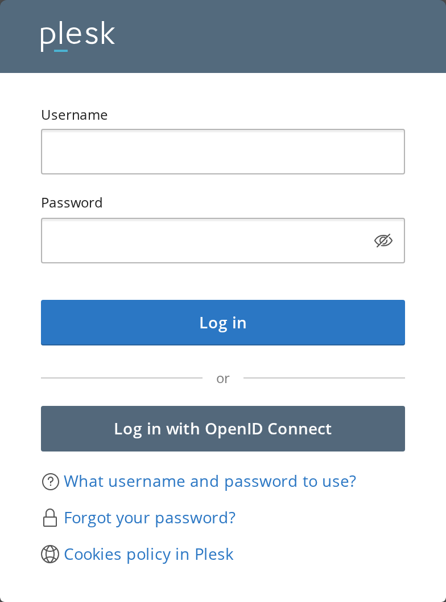
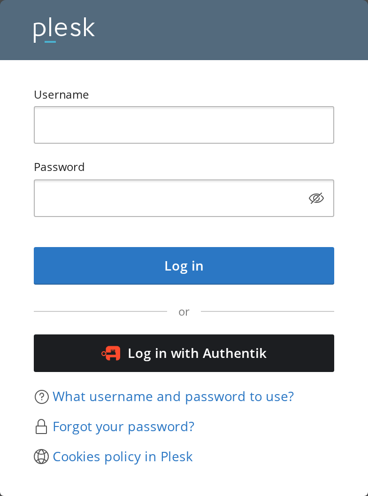
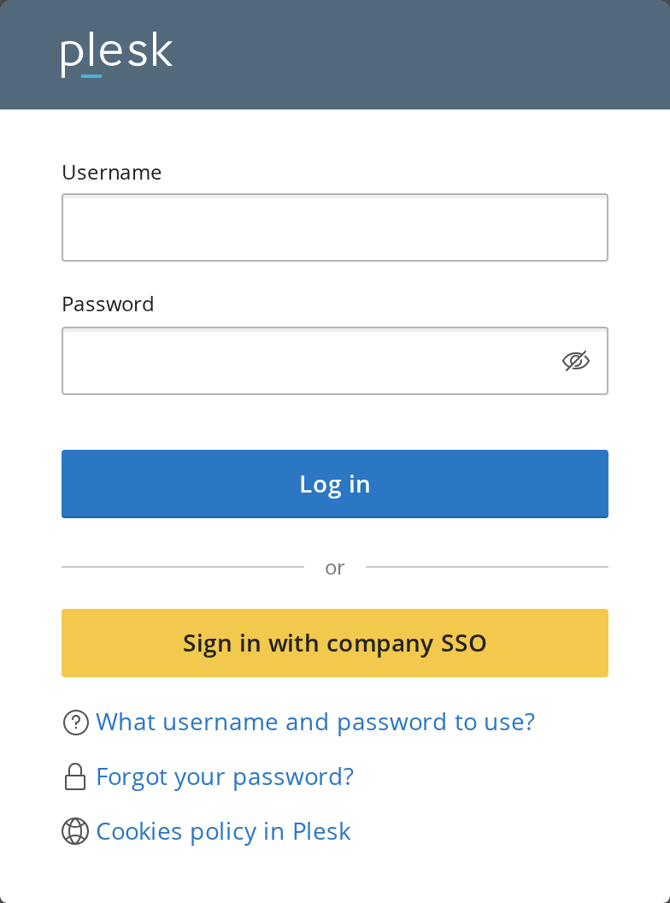

# Plesk OIDC

Log in to Plesk as an administrator through any OpenID Connect provider.

Each user gets a personal Plesk administrator account, created on their first login.

## Requirements

* Plesk 18.0.82 or later.
* An OpenID Connect provider that signs ID tokens with RSA.

## Install

1. Download the latest zip from [Releases](https://github.com/Supergamer1337/plesk-oidc/releases).
2. In Plesk, go to Extensions, open My Extensions and click Upload Extension.

## Set up

1. Open Plesk OIDC from My Extensions.
2. Create a client at your provider with the Redirect URI shown on the settings page.
3. Enter the Issuer URL, Client ID and Client secret of that client.
4. Set Admin group to the group that may log in.
5. Save.

A Log in with OpenID Connect button now shows under the Plesk login button.

Change Callback host if users reach Plesk through a different URL.

## Login button

Change the text, color and icon of the button under Login button on the settings page.
The text turns white or dark to stay readable on the chosen color.

  
  
  

The icon is loaded by the browser of each visitor, so host it on a server you trust.

## How accounts work

* The first login creates an additional administrator named after the identity claim.
* Later logins reuse that account, even if the identity claim changes.
* A login is refused if its name already belongs to another Plesk account.
* Leaving the admin group blocks new logins but keeps the Plesk account.

> [!WARNING]
> Without an admin group, everyone who can sign in to the client becomes a Plesk administrator.

## Troubleshooting

Failed logins are logged with their cause in `/var/log/plesk/panel.log`.
